<p align="center">
  <picture>
    <source media="(prefers-color-scheme: dark)" srcset="docs/assets/logo-light.svg">
    
  </picture>
</p>

<h1 align="center">Marble Trace</h1>

<p align="center">
  <strong>Open-source iRacing telemetry overlay — beautiful, lightweight, always on top.</strong>
</p>

<div align="center">

[](https://github.com/mvoof/Marble-Trace/releases) [](LICENSE) [](CONTRIBUTING.md)  

</div>

<p align="center">
  Marble Trace™ is actively developed — new widgets, fixes, and features land regularly.<br>
  Got a bug, an idea, or just want to share your setup? Join the community on Discord.
</p>
<p align="center">
  <a href="https://discord.gg/tkdS9sn49b">
    
  </a>
</p>

---

## Why Marble Trace?

Most iRacing overlays are either bloated desktop apps or locked behind subscriptions. **Marble Trace** is different:

- **Rust core** — a tiny Rust backend reads telemetry directly via [kerb](https://github.com/mvoof/kerb), our own multi-sim shared-memory telemetry library; the UI is a transparent frameless window that floats above the sim.
- **Fully modular** — enable only the widgets you need. Every widget is positioned, scaled and styled on its own inside a single transparent overlay that spans all of your monitors.
- **Layouts for every session** — build as many layouts as you race disciplines, arrange them across your monitors in a visual editor, and switch between them by key or automatically by session, car class or car.
- **Any screen you own** — a layout can also feed a phone, a tablet or a second PC over your local network, with nothing to install on the device.
- **Your own numbers** — Home turns the sim's telemetry files into statistics of your driving, and Analysis lays your laps over each other, channel by channel.
- **Free & Open Source** — licensed under GPLv3, free to use, modify, and contribute to.
- **Modern stack** — Tauri v2 + React 19 + MobX + Ant Design. Fast and type-safe.

---

## Widgets

Every widget is independently positioned, resized, and styled — drag it anywhere on screen, scale it to taste, adjust opacity so it never blocks your view. Each one ships with its own set of options: toggle individual data fields, switch layouts, pick colours, set visibility rules. You only see what you actually need, exactly where you want it.

- **Driving HUD** — [Race Dash](#race-dash) · [Invisible Dash](#invisible-dash) · [RPM Lights](#rpm-lights) · [Engine Panel](#engine-panel) · [Battery](#battery) · [DRS](#drs) · [ABS](#abs) · [Input Trace](#input-trace) · [G-Meter](#g-meter) · [Coach](#coach)
- **Timing & Standings** — [Standings](#standings) · [Relative](#relative) · [Relative Map](#relative-map) · [Delta](#delta) · [Sector Matrix](#sector-matrix) · [Lap Log](#lap-log) · [Timer](#timer)
- **Awareness** — [Track Map](#track-map) · [Proximity Radar](#proximity-radar) · [Radar Bar](#radar-bar) · [Radio](#radio) · [Crew Radio](#crew-radio) · [Close Battle](#close-battle) · [Wheel to Wheel](#wheel-to-wheel) · [Flags (LED/Flat)](#flags-led--flat)
- **Car & Session** — [Pit Service](#pit-service) · [Pit Line](#pit-line) · [Fuel](#fuel) · [Weather](#weather) · [Incident Tracker](#incident-tracker)
- **Streaming** — [Stream Chat](#stream-chat)

---

## Driving HUD

### Race Dash

Cockpit cluster combining a gear ring, speed readout, lap/position/RPM stats, a live driving-coach tab, and a dedicated pit-lane mode.

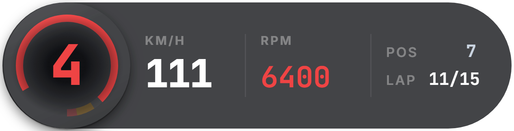

---

### Invisible Dash

A windscreen projection instead of a panel: the engine column and gear on the left, position and lap on the right, and nothing in the middle, so the road stays clear.

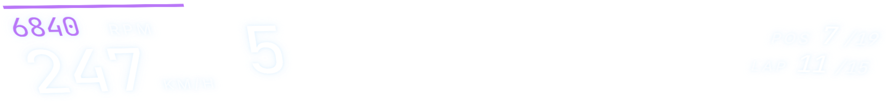

---

### RPM Lights

Standalone shift-light LED bar driven by engine RPM, with configurable colour zones and pit-limiter animations.


---

### Engine Panel

One strip per system, always in the same order: brake bias as the large figure, then traction control and ABS, the formula cars' engine braking with peak and fine bias, the differential, the anti-roll bars, and the engine readings — water and oil temperature, oil pressure, voltage — at the bottom. A strip your car has no controls for is left out, so every value stays where you expect it; an overheating temperature turns red.

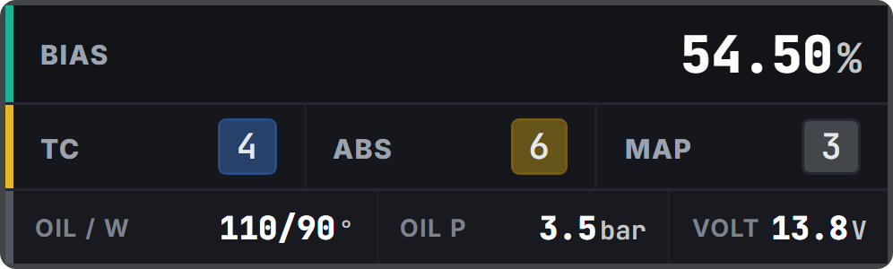

---

### Battery

Hybrid battery charge as slanted cells and a large figure, coloured green, yellow or red by charge; what the MGU-K is doing with it — IDLE, DEPLOY or REGEN, and how hard — and the energy spent on the lap. On cars that expose a deploy-mode selector, the modes sit on their own strip with the current one lit.

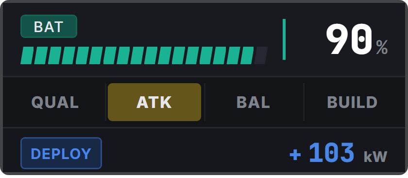

---

### DRS

Drag reduction system state at a glance: armed past the detection point, ready inside the zone, open.

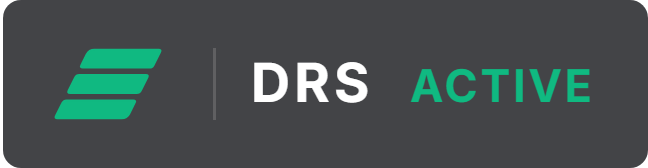

---

### ABS

The ABS setting from the cockpit, 0 to 12, beside a badge that lights yellow while ABS is working and stays a quiet grey otherwise. Switch the level off to keep only the badge; on a car with no ABS adjustment the widget hides itself.

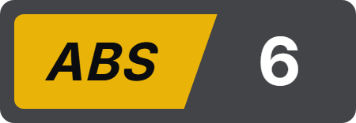

---

### Input Trace

Watch your throttle, brake, and clutch inputs scroll in real time. The trace shows a rolling history so you can see exactly where you're trail-braking, blipping, or lifting early; the pedal bars beside it light their end stops once a pedal is touched and when it is fully pressed.

The speed and gear sit at the top of their block with the corner's entry, apex and exit speeds as chips — under them, above them, or beside them in a column. The steering block draws the built-in dial, one of several wheel silhouettes, or a picture of your own wheel that turns with the steering. Adding another built-in wheel is a traced product photo — see [docs/steering-wheel-assets.md](docs/steering-wheel-assets.md).

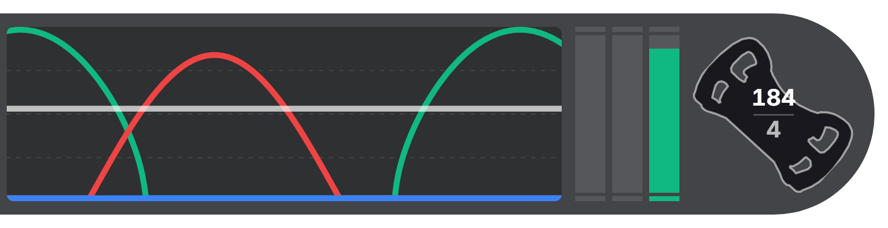

---

### G-Meter

Friction circle visualising lateral and longitudinal G-forces in real time. Three display modes — **Trail** (fading line history), **Fading** (decaying envelope), **Peak** (static max-G envelope) — with three colour modes: **Mono**, **Simple** (red brake / green accel / cyan turn), and **Advanced** (smooth gradient blending). Adjustable scale from 2 G to 5 G.

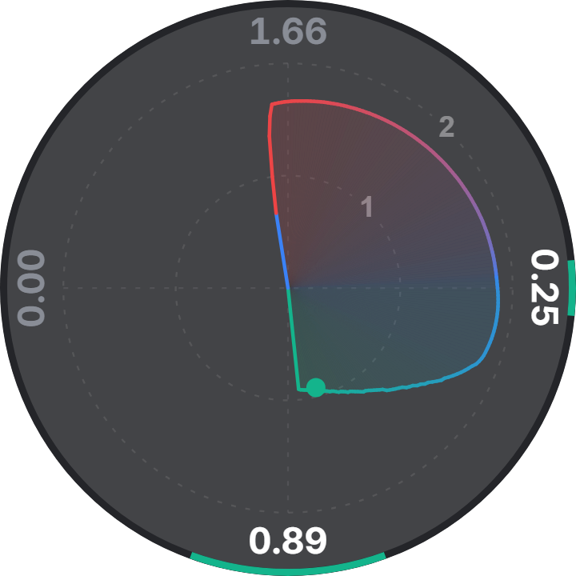

---

### Coach

Live braking and throttle coaching against your stored best lap. The call chip tells you what to do right now — **BRAKE** before the braking point, or a corner-exit **GAS** call — beside the speed gap to your reference lap, and **IN**, **APEX** and **OUT** light up in turn as you pass through the corner, each with the time it won or lost. Underneath, a rolling speed trace plots your current lap against the reference lap in a configurable window (in metres). The footer shows current vs reference speed, the reference lap time and the corner's total. Both rows can be switched off independently, and every colour is configurable.

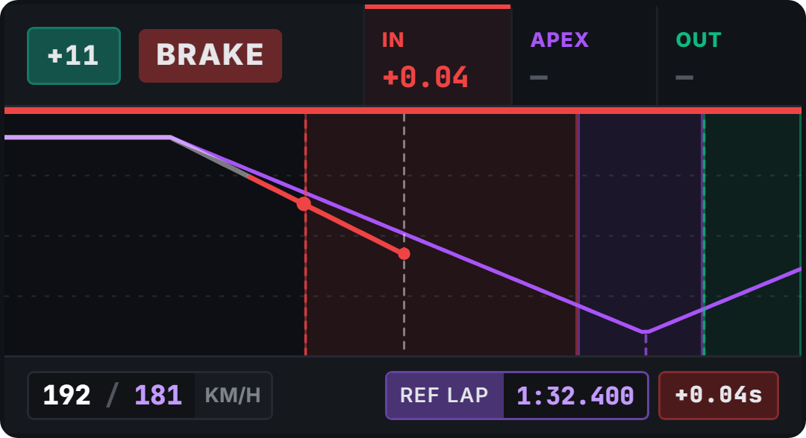

---

## Timing & Standings

### Standings

Full race standings table with multi-class support: safety rating and iRating chips, laps, gap, interval to the car above, last lap with its delta to the one before, best lap (purple for the class best, green for a personal best), car make and tire. The header carries the session, field size, SOF, laps and clock around the track name; the footer the track conditions, your pit stops and incidents. Cars on pit road show how long they have been there, a driver's flag — blue, black, meatball — is drawn beside the name, and in team events the team sits under the driver.

Every column can be switched off and dragged into a different order, and the table switches between the combined leaderboard and a single-class view with its own SOF and field size.

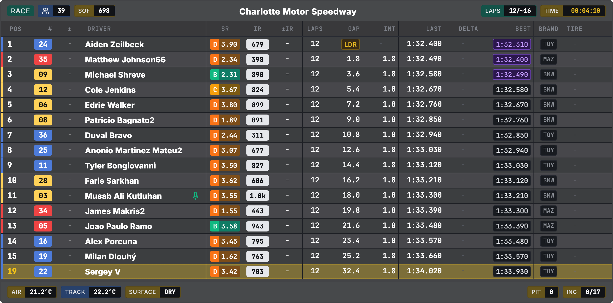

---

### Relative

The cars around you on track, player always centred, in the same chip style as Standings: class stripes, safety rating and iRating, the gap — blue for cars ahead, red behind — and optionally the bumper-to-bumper distance. Lapping and lapped cars, pit time and flags read as they do in Standings; columns can be reordered or switched off, and making the widget taller adds rows one at a time.

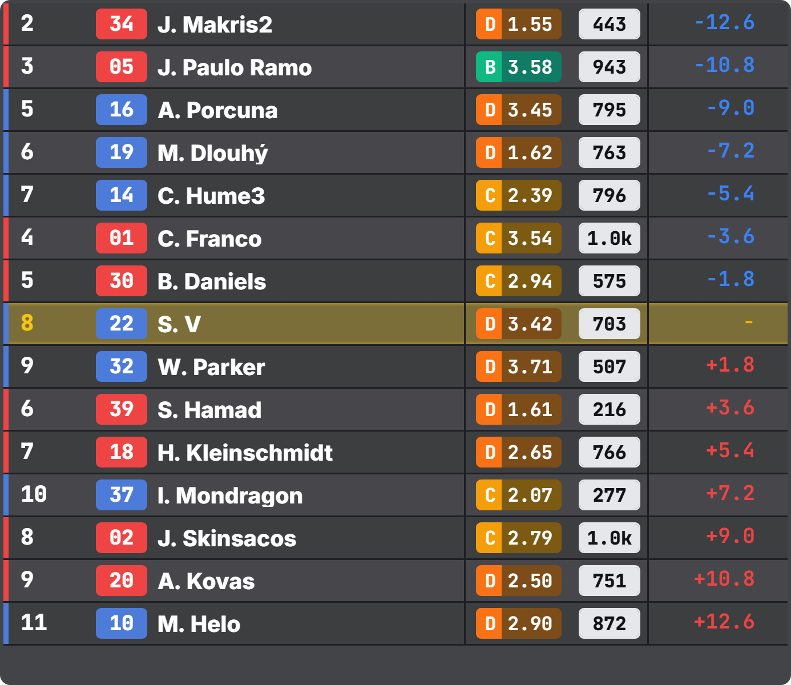

---

### Relative Map

Compact 1-D track map showing relative car positions along the lap. Horizontal or vertical.

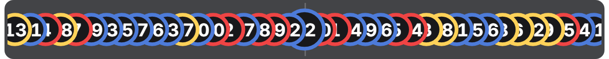

---

### Delta

Live delta bar that compares your current lap against a configurable reference — your personal best (PB), your personal optimal (PO, best sectors combined), session best (SB), session optimal (SO), or the previous lap in the session (SL) — switched in its own block beside the plate. The bar fills green when you are ahead and red when behind. When you cross the finish line a lap flash card appears (top, bottom, left, or right of the widget) showing the completed lap time and its delta. Card display duration is adjustable.


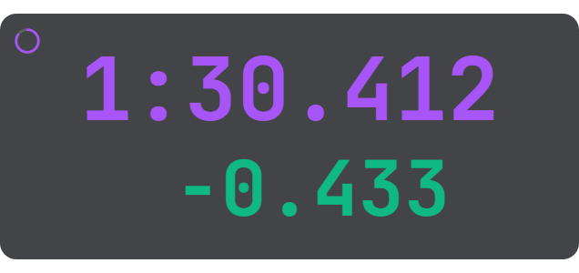

---

### Sector Matrix

The lap as a grid of sectors: each cell edged in its state with its delta to your personal best as a chip, **LIVE** on the sector you are in, and last lap's time dimmed on the sectors still ahead. The header carries the lap with its running time and the predicted lap time; a segmented bar fills sector by sector, and **LAST** and **BEST** sit underneath. Four sectors make a square, more add rows of three. The reference for the prediction is configurable, and PRED, LAST, BEST and the progress bar can each be hidden.

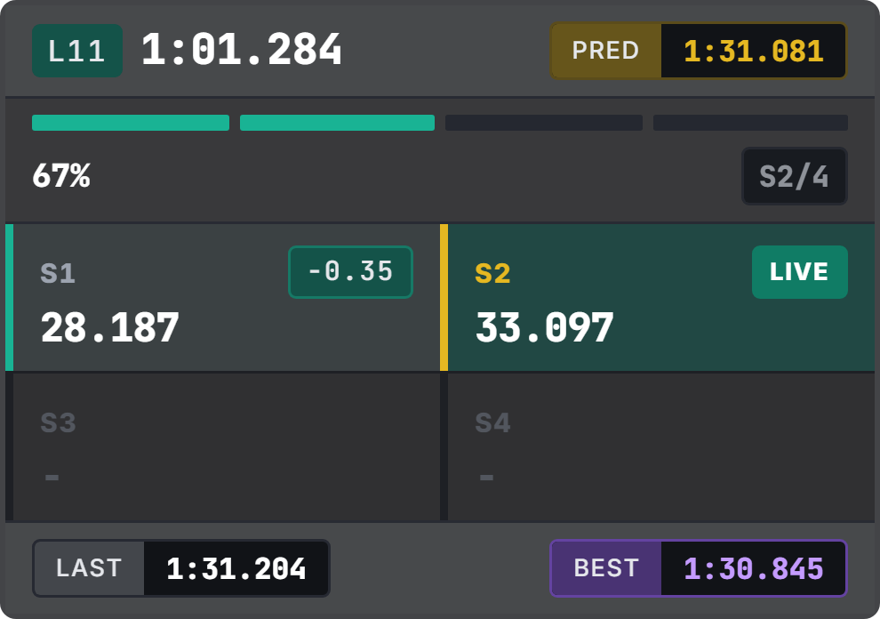

---

### Lap Log

Rolling history of your completed laps — lap, time, and the loss to your best as a chip: yellow up to half a second, red past it, a purple **BEST** on the best lap and **INV** on an invalid one. The lap being driven sits on top as **RUN**, the header carries your best lap and the footer the average of the valid laps. The height decides how many laps show, up to 50; the delta can be drawn as pace-loss bars or hidden.

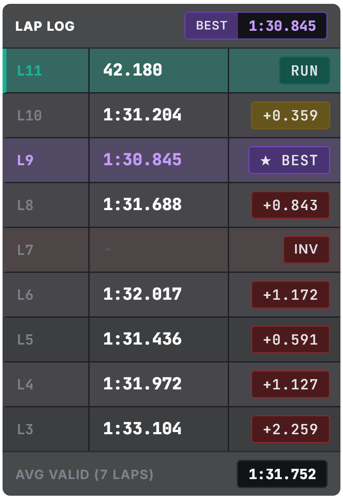

---

### Timer

Session clock with laps-to-go, estimated total laps, and optional real-time clocks.

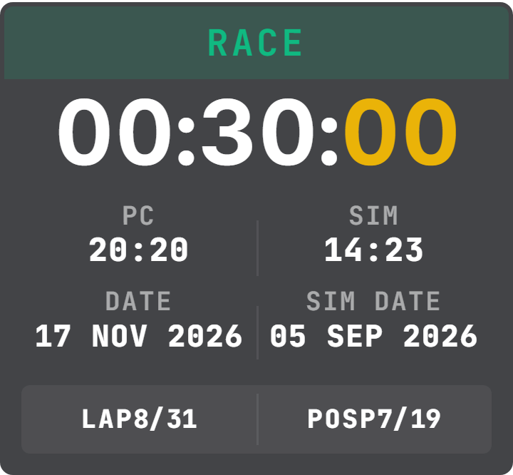

---

## Awareness

### Track Map

SVG overhead track map with every car's position, class-coloured dots, P1 / YOU labels, class legend, sector markers and a checkered start/finish bar — recorded from your own lap data.

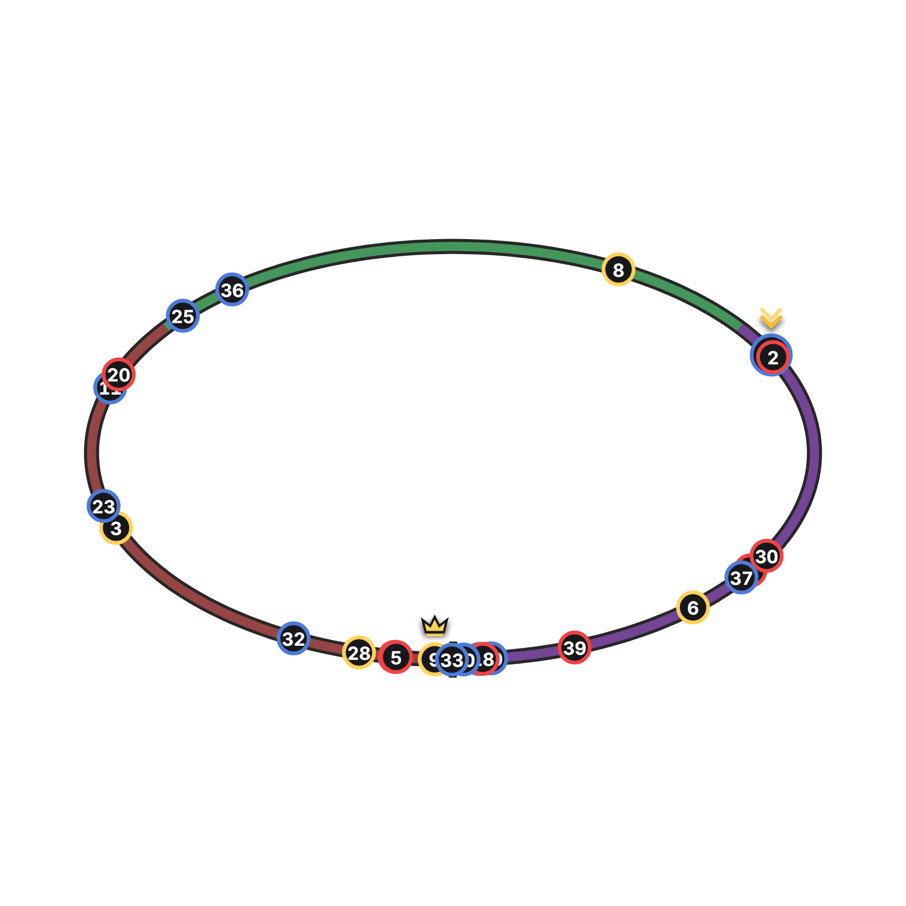
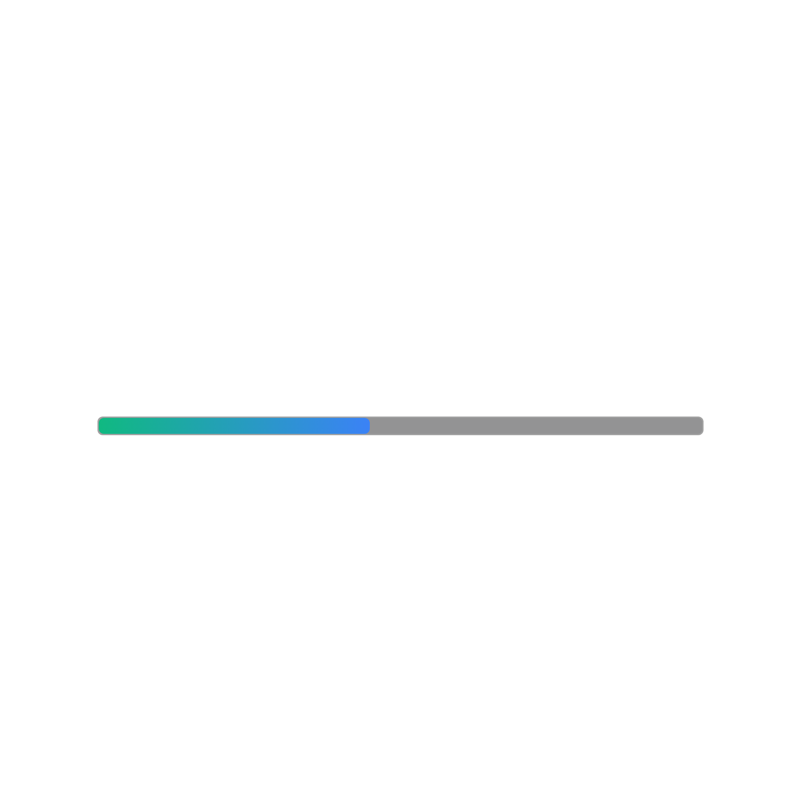

---

### Proximity Radar

Circular radar centred on your car with a configurable render range, bumper-to-bumper gap labels, sector masks, and spotter cones.

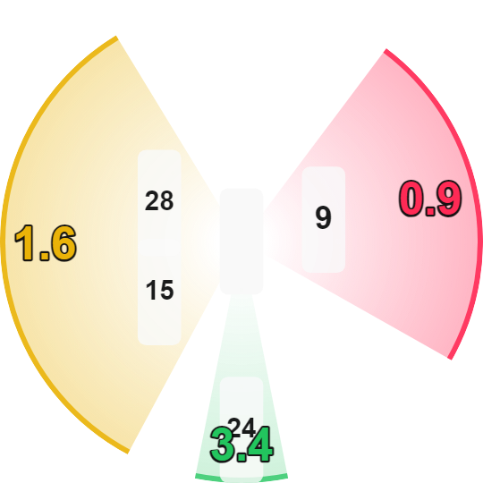

---

### Radar Bar

Full-width edge indicators for side-by-side situations — a quick-glance signal for cars in your blind spot.


---

### Radio

Who is talking on the radio, in place of the sim's own indicator: the car number in its class colour, the channel the sim names — all, drivers, team, race control, admin, private or one of your own — in the opposite corner, and the driver's name large over a wave in the channel's colour, the surname on its own line or shortened to "First L.". Your own voice shows too, while you hold push-to-talk. With nobody on the air the plate shows your channel alone — for a moment after you switch, or all the time if you want it on screen.

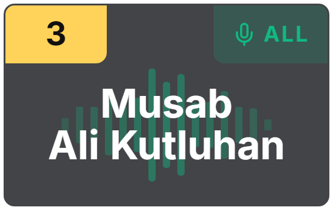

---

### Crew Radio

The voice engineer's side of the radio: what you said while holding push-to-talk, the engineer's reply while it is spoken and a moment after, and a ✓ or ✗ beside a pit command once the sim took it or refused it. It shows the current line alone or the last few, and can leave your own lines out.

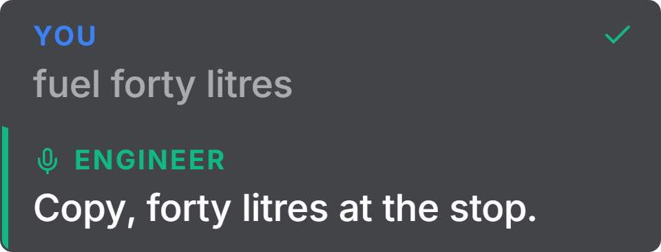

---

### Close Battle

The cars actually fighting you, drawn on a vertical distance axis instead of a list: ahead goes up, behind goes down, and the plate sits where the car is. It appears on its own — set it off by a gap in seconds or a real distance, and the axis then scales itself to that threshold, in metres or feet to match your unit setting.

Each plate carries the car number, the class on its livery panel, the driver, the distance and the gap; cars landing on the same spot share one plate that names both of them rather than shoving each other aside. Plates shrink with distance, and the road glows red behind you or blue ahead as a car closes in.

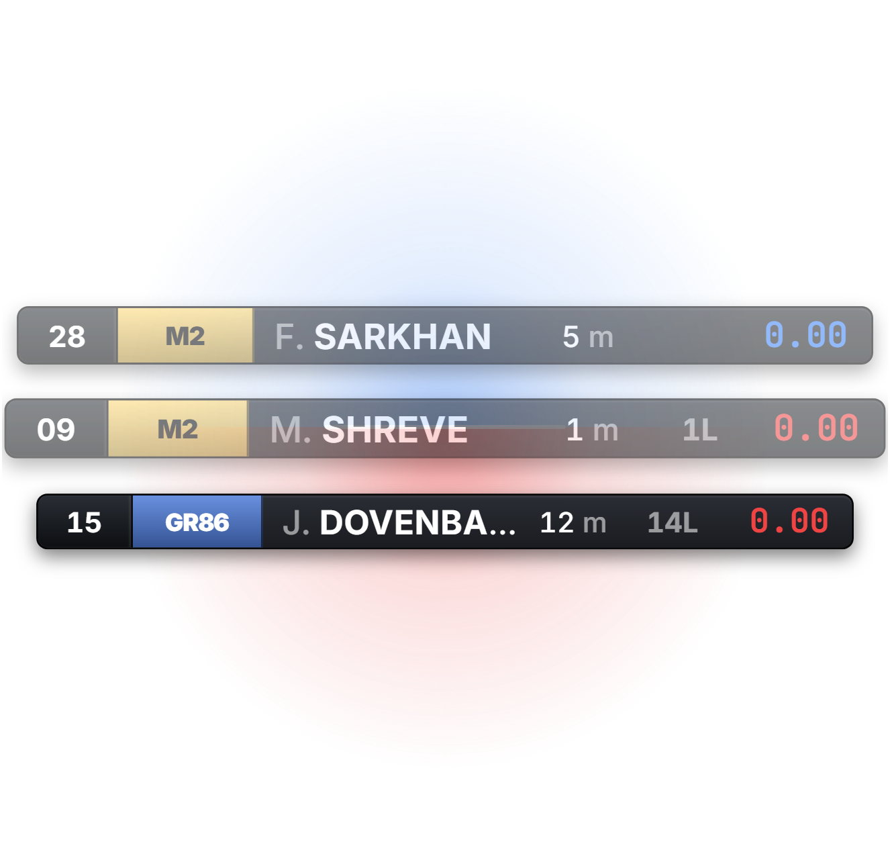

---

### Wheel to Wheel

You and your nearest rival side by side: each car's number, position and name, its speed against yours, and the gap between you.

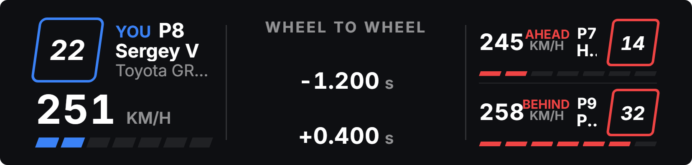

---

### Flags (LED & Flat)

LED matrix and flat banner-style flag indicators with green, yellow, red, blue, white, checkered, and meatball flag support.

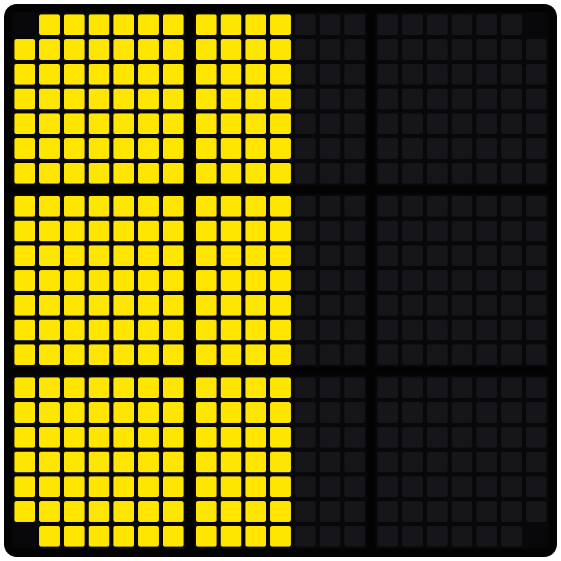
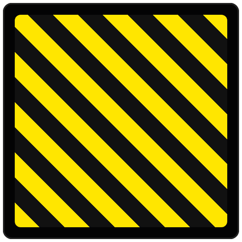
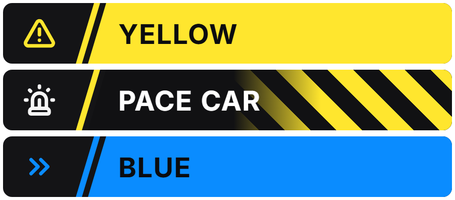

---

## Car & Session

### Pit Service

Everything about the stop in one plate: live pit-lane speed against the pit limit, the fuel you are about to add, repair times (required, optional and fast repairs left — **REPAIR DONE · GO** once they have run out), windshield tear-offs, the compound, and a per-corner tire grid with temperatures and remaining wear, each corner green when new tires are ordered. The footer shows whether you are in the box and the position you will rejoin in, counting the time the pit lane itself costs.

In interact mode each tire takes a − and + for its pressure, and hotkeys raise or lower all four at once. Optional automation adds fuel for you and orders new tires once wear drops below a configurable threshold. Blocks (speed, fuel, tires, repairs, footer) are toggled individually.

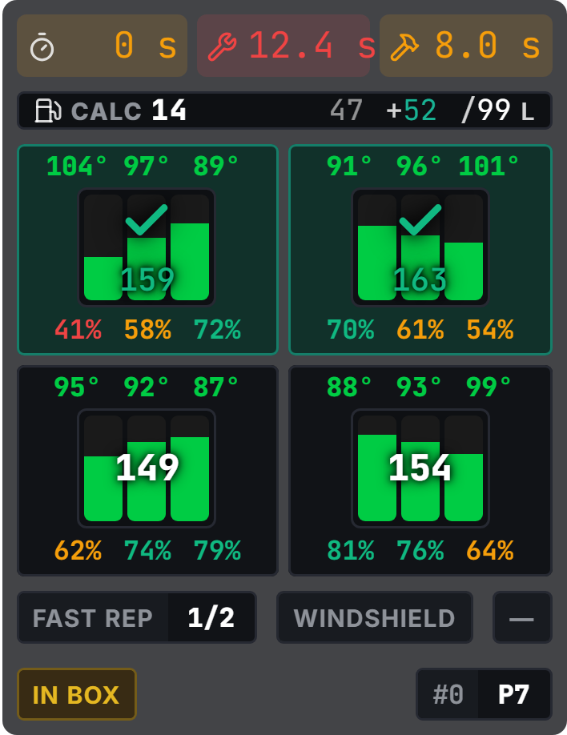

---

### Pit Line

Pit lane speed against the limit, and the roll to your stall — as a vertical or a horizontal rail.

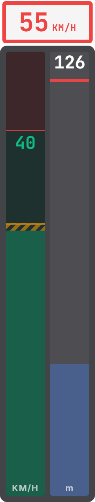

---

### Fuel

The tank, what it lasts, and when to stop: a quartered tank bar under the fuel left, a lap-by-lap consumption chart (line or bars), and the last, lowest and highest consumption with the laps each would last.

- **LAPS LEFT:** Current driving range in laps, in a box coloured by urgency.
- **FINISH:** Projected fuel balance (surplus or deficit) at the end of the race.
- **NEXT PIT / PIT WINDOW:** The laps you can stop on; once you need to refuel, how much to fill now (with a +1 lap buffer) to reach the finish, and how many stops it takes.

The low-fuel warning, the averaging window and counting laps under yellow are set once, under Shared Values, and every Fuel widget follows them.

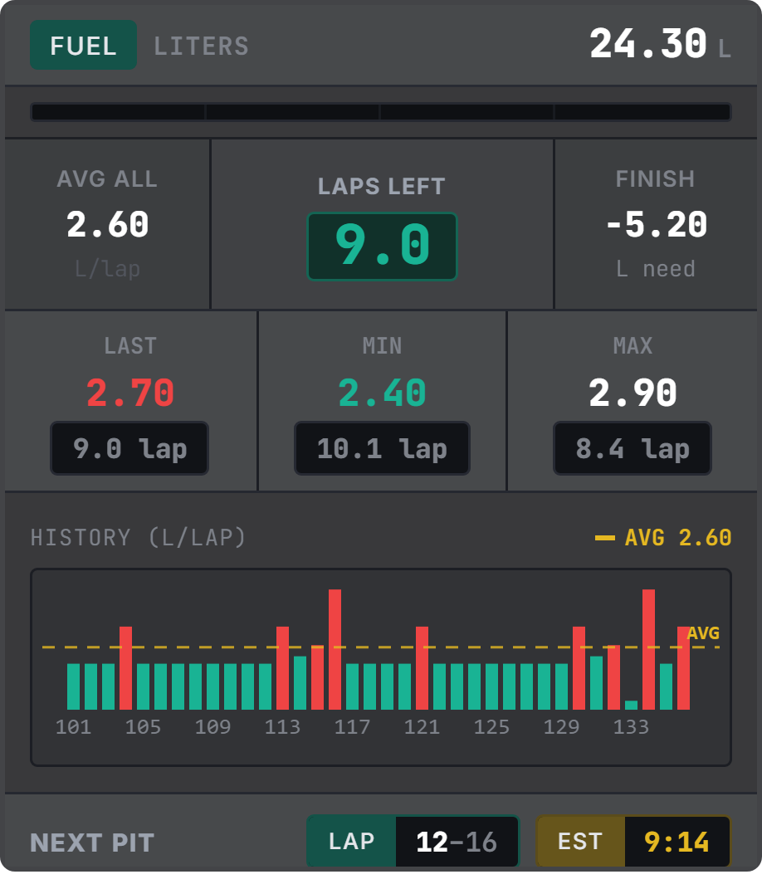
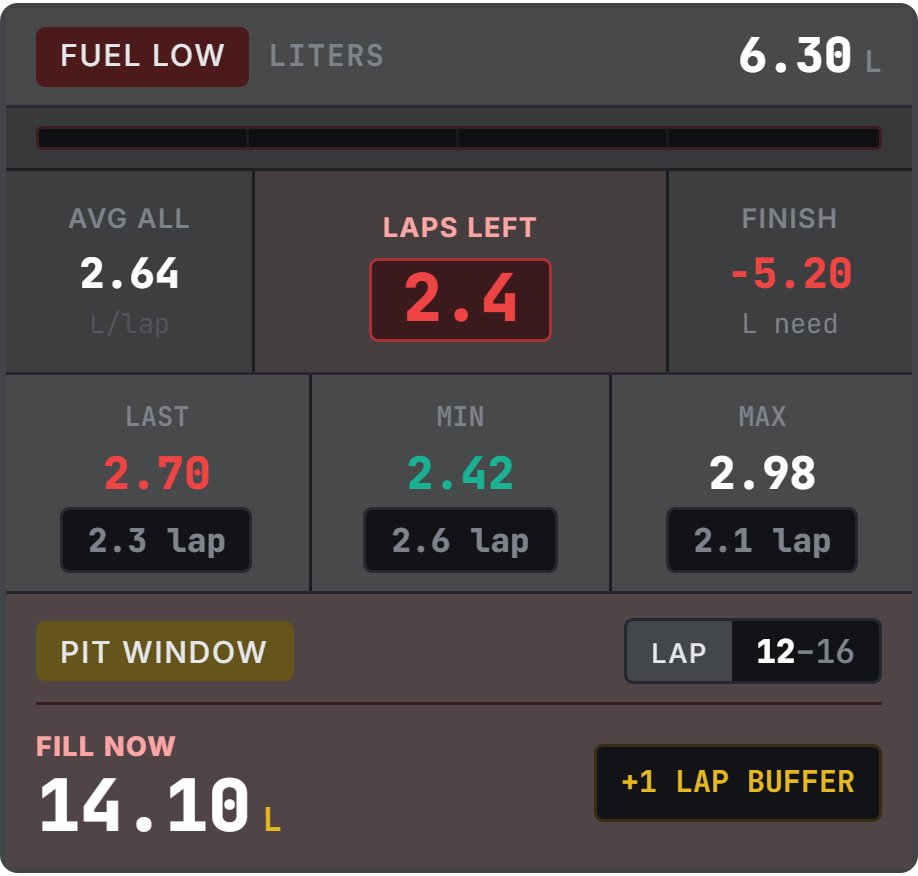

---

### Weather

Wind direction compass, temperature, humidity, and forecast strip for dynamic weather sessions.

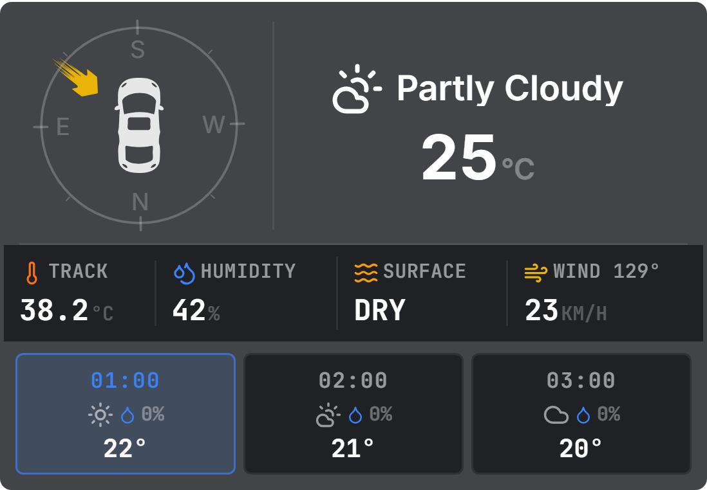

---

### Incident Tracker

Your incidents against the session limit, the drive-throughs served and how many points are left before the next one, and an estimate of where your Safety Rating lands at the flag — the SR badge in your license colour, with the clean corners it would take to break even. Near the limit the points left turn red and blink, and the whole widget is framed in red; the penalty column is left out in a session that hands out none. The rating is an estimate from a community model (see [Credits](#credits)); a session that does not move it shows **OFF**.

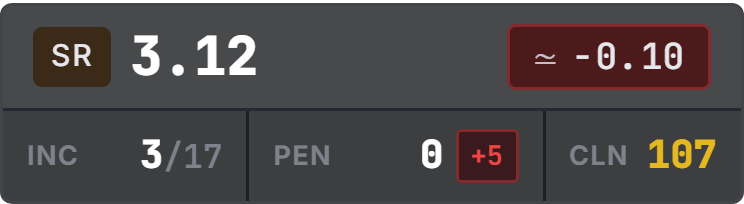

---

## Streaming

### Stream Chat

Twitch and YouTube live chat merged into a single feed on top of the sim, so you can read your stream without alt-tabbing. Messages carry a platform glyph and role badges (moderator, VIP, subscriber) as compact text plates or the original badge artwork. Channel events — raids, subs, cheers and donations — appear as highlighted rows, and the footer strip shows viewer counts, message rate and totals. Row density, message limit and auto-expiry are configurable, and every block can be turned off.

Viewers can ask the sim themselves: `!pos`, `!gap`, `!lap`, `!best`, `!sof`, `!car`, `!weather`, `!fuel` and more get a reply in your Twitch chat with live session data, each command with its own switch and cooldown.

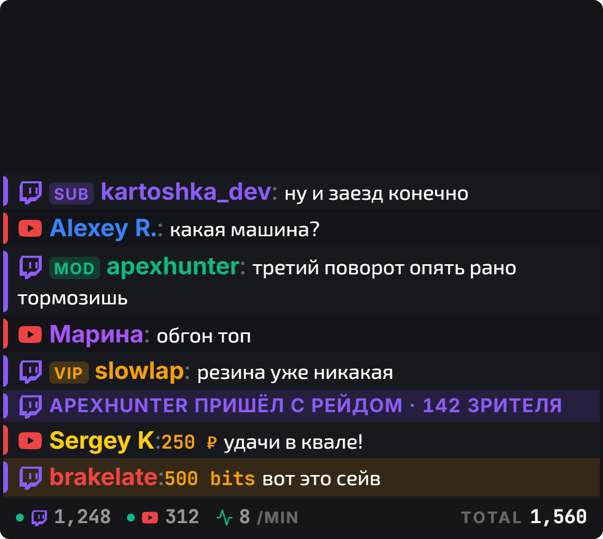

---

## Layouts & Screens

### Layout Editor

Every layout is arranged in a visual editor that mirrors your actual desktop: each monitor is drawn to scale in its Windows position and has its own widget list — switch a widget on for the screen you want it on, run a second instance of it on another screen with its own settings, or move one over with every setting it has. Zoom out for the whole desktop when you are moving things around, or into a single screen for detail work. Each monitor can carry its own background image so you can place widgets against a screenshot of the cockpit instead of an empty rectangle, and everything follows along if you rearrange your displays in Windows.

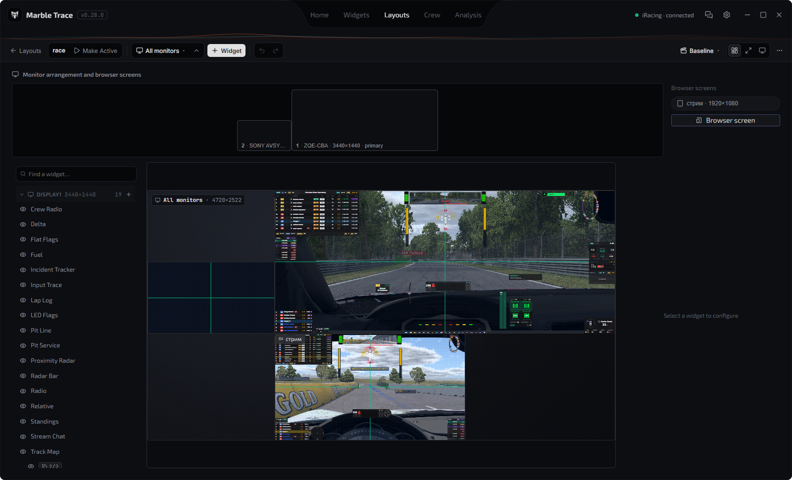

Layouts are independent of each other — build one for endurance, one for qualifying, one for ovals. Each remembers which screens it uses and which widgets sit on them. Switch between them from the toolbar, by a key or wheel button, or let the app switch automatically by session type.

### Remote Screens

A layout can also contain screens with **no monitor behind them**. Marble Trace serves those screens over your local network, so a phone, a tablet or a second PC opens one in its browser and shows live widgets — the same widgets, settings and telemetry as the overlay, with nothing to install on the device.

- **Scan and go** — every remote screen has a QR code in Settings. Point the device's camera at it instead of typing an IP by hand, then add it to the home screen to run it full-screen.
- **Fit to the device** — the device reports the viewport it actually has, and one click resizes the screen to match, carrying its widgets with it.
- **Token protected** — the link carries an access token, hidden until you ask for it (so a window capture on stream never puts it on air), copyable while covered, and regenerable at any time. Serving to the network is a separate switch; with it off nothing leaves this machine.
- **Read-only by protocol** — a connected device paints what it is sent and cannot write anything back into your settings.
- **Tunable** — the port and the telemetry push rate (5–60 Hz) are configurable, so a phone on weak Wi-Fi can be given less to chew on.

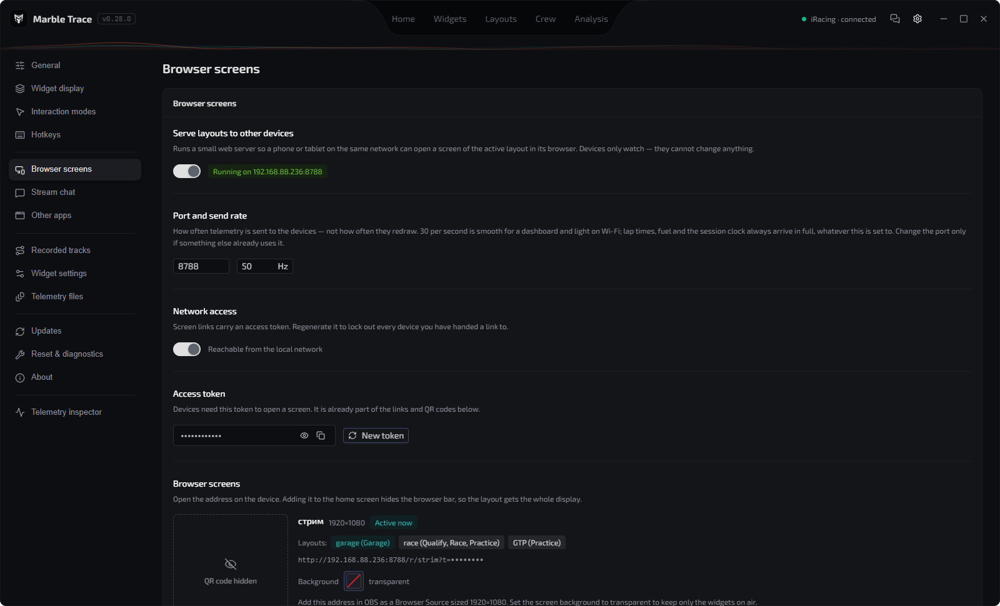

Remote screens appear on the layout canvas next to your monitors, can be dragged anywhere on it, and a **Tidy remote screens** button lays them out in rows under the desktop.

---

## Input Devices

Every action can be bound to a keyboard key **or** to a button on your wheel, button box, joystick or handbrake — read straight from the device, so bindings still fire while iRacing has focus. All of them live in one **Input bindings** screen in Settings, grouped by widget, with search and a warning next to any button used twice; one action can carry several bindings at once.

Bindings are app-wide, not per layout. Devices are matched by their DirectInput instance GUID, so replugging or moving to another USB port keeps your bindings; a driver reinstall that regenerates the GUID is re-matched by vendor and product. A device that is currently unplugged keeps its bindings too, shown greyed out until it comes back.

---

## Performance

The overlay is a transparent window over the sim, and every time its content changes Windows composes a new frame on the same GPU the game is drawing on. So Marble Trace redraws the overlay on **one clock** — 30 times a second by default, nothing animating in between — while the telemetry behind it is still computed at the sim's full rate. Tables, fuel and weather update at their own slower rates on the same clock.

- **Tunable** — Settings → Overlay → Overlay update rate: 60, 30, 20 or 15 Hz. 60 is the smoothest motion and costs the game the most frames.
- **Measured, not guessed** — on an iRacing replay with every widget on screen, the overlay costs about 8% of the average frame rate; going from 60 Hz with animated bars to the 30 Hz clock raised the 1% low by 40% and cut stutters by two thirds.

How it is measured: [docs/perf-methodology.md](docs/perf-methodology.md). Why it is built this way: [ADR-0009](docs/adr/0009-overlay-changes-on-one-clock.md).

---

## Installation

Download **`Marble Trace_<version>_x64-setup.exe`** from the [latest release](https://github.com/mvoof/Marble-Trace/releases/latest) and run it. There is nothing else to install.

> [!IMPORTANT]
> Only `-setup.exe` is supported. If you still have a copy installed from an `.msi`, remove it through Windows **Apps & features**, then install once from `-setup.exe`. Your settings, layouts and bindings are kept — they live in `%APPDATA%\com.voof.marble-trace`, not in the installation folder.

---

## Development

```bash
npm install
npm run tauri:dev
```

Prerequisites, every script, the workflow and the environment variables are in
[CONTRIBUTING.md](CONTRIBUTING.md); every developer doc, by task, in
[docs/README.md](docs/README.md).

---

## Analytics & Privacy

Marble Trace uses [Aptabase](https://github.com/aptabase/aptabase) — an open-source, privacy-first analytics platform. No personal data is collected. The following anonymous events are tracked:

| Event         | When                                                                                       |
| ------------- | ------------------------------------------------------------------------------------------ |
| `app_started` | On every launch — includes primary monitor resolution, scale factor, system locale and DPI |

Aptabase automatically captures: OS, app version, country (from IP), and locale. No user IDs, no file paths, no telemetry data from iRacing.

---

## Contributing

Contributions, bug reports, and feature requests are very welcome!
Please read [CONTRIBUTING.md](CONTRIBUTING.md) before opening a PR.

---

## Changelog

See [CHANGELOG.md](CHANGELOG.md) for the full release history.

---

## Credits

Marble Trace's Safety Rating estimate comes from the community, not from iRacing — iRacing does not publish the formula, and the widget shows the number as an estimate.

- **Safety Rating** — the model reconstructed by [Nishizumi-SR](https://github.com/nishizumi-maho/Nishizumi-SR) (MIT) from iRacing's official before/after CPI on 123k race sessions.

---

## Trademarks

<!-- Keep this list in step with the names the README actually uses, and with
     the footer of site/index.html (footer-legal), which lists the names the
     site uses: a newly named product goes into both. -->

Marble Trace™ and the Marble Trace logo are trademarks of voof. iRacing is a trademark of iRacing.com Motorsport Simulations, LLC. TAURI is trademark of The Tauri Programme within the Commons Conservancy. Rust is a trademark of the Rust Foundation. Windows is a trademark of the Microsoft group of companies. GitHub is a trademark of GitHub, Inc. Discord is a trademark of Discord Inc. Twitch is a trademark of Twitch Interactive, Inc. YouTube is a trademark of Google LLC.

All other names, Aptabase among them, are the property of their respective owners.

**Marble Trace is an independent open-source project. It is not made by iRacing, has no connection to iRacing.com Motorsport Simulations, LLC, and is not affiliated with, sponsored or endorsed by it or by any of the companies above.**

---

## License

The Marble Trace source code is licensed under the [GNU General Public License v3.0 (GPL-3.0)](LICENSE). © 2026 voof

The Marble Trace name, logo, and other branding are not licensed under the GPL-3.0. Permission to use, modify, and distribute the source code does not grant permission to use the Marble Trace name or logo in a way that suggests an official or endorsed version.

Forks and derivative works that are distributed (conveyed, in the GPL's terms) must comply with the GPL-3.0 license; private modifications you do not distribute carry no such obligations. If you distribute a modified version under a different name or branding, please make it clear that it is not the official Marble Trace project.
