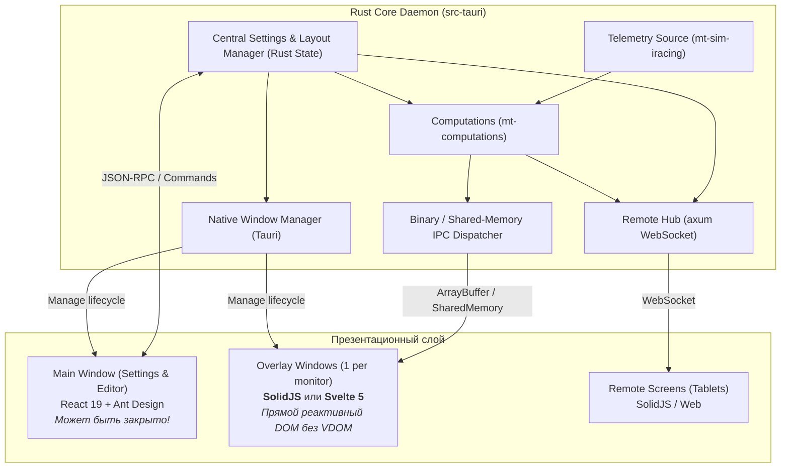
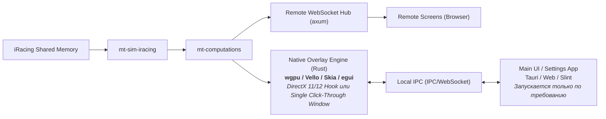

# Архитектурный аудит и предложение новой архитектуры Marble Trace

> **Цель документа:** провести всесторонний анализ текущей архитектуры Marble-Trace, выявить худшие проектные решения, антипаттерны и узкие места в коде, определить файлы и модули под удаление/переписывание, а также предложить принципиально новую архитектуру, избавленную от накопленного техдолга.

---

## 1. Общий обзор и сильные стороны проекта

Marble-Trace — зрелый проект с высоким уровнем инженерной культуры. Перед тем как перейти к критике, необходимо зафиксировать то, что выполнено отлично и должно быть сохранено:

1. **`mt-computations` — эталонная предметная логика:**
   - Чистые функции и структуры без I/O, зависимости от Tauri или конкретного симулятора.
   - Высокое покрытие юнит-тестами (модель Safety Rating, расчет расхода топлива, детекция пит-лейна, дельты круга).
2. **Изоляция адаптера симулятора (`mt-source` и `mt-sim-iracing`):**
   - Прямой контакт с `kerb` и SDK iRacing изолирован в одном крейте. Нормализация индексов (1-based), декодирование флагов и погоды происходят на границе.
3. **Строгий линтинг архитектурных слоев (FSD на фронтенде, Cargo workspace на бэкенде):**
   - Запрет циклических зависимостей, четкое разделение `shared → entities → features → widgets → pages → app`.
4. **Контрактная типизация через Specta и `ts_values!`:**
   - Автоматическая кодогенерация типов TypeScript из Rust-структур устраняет человеческий фактор при изменении DTO.

Однако вокруг этого качественного ядра выстроена тяжелая, противоречивая и местами откровенно порочная система взаимодействия компонентов.

---

## 2. Худшие идеи и архитектурные антипаттерны в коде

### Антипаттерн №1: Использование React 19 + MobX для высокочастотного (30–60 Hz) оверлея и костыльный «DOM Bypass»

- **Суть проблемы:** React спроектирован для компонентных пользовательских интерфейсов с относительно низкой частотой мутаций. Внутренний профайлинг проекта (`docs/rendering.md`) показал:
  - **57%** всех аллокаций памяти — вызовы `jsxDEV` (создание VDOM-объектов).
  - **17%** — работа Fiber reconciler.
  - Потребление памяти оверлеем доходило до **1.0–2.5 ГБ**.
- **Как проблему «решили» в проекте (худшее решение):**
  Вместо отказа от React для виджетов оверлея или перехода на реактивный прямой рендеринг (SolidJS, Svelte 5, PixiJS, Canvas) был придуман чудовищный костыль — **`useReactiveDomWrite`** (`src/shared/hooks/useReactiveDomWrite.ts`):
  1. Создан поддельный React `RefObject` с геттером и сеттером `current`, чтобы перехватывать момент маунтинга DOM-ноды.
  2. Внутри поднимается MobX `autorun`, который слушает observables и планирует вызов через `requestAnimationFrame`.
  3. Внутри компонентов (например, `DriverRow.tsx` в `relative` виджете) код превращается в античный jQuery:
     ```tsx
     // oxlint-disable-next-line no-restricted-properties
     const entries = computed.relativeEntries;
     scheduleWrite(() => {
       element.classList.remove(styles.f2Player, styles.f2Positive, styles.f2Negative);
       element.classList.add(gapClass);
       element.textContent = liveDriver.isPlayer ? '-' : gapText;
       const row = element.closest('[data-relative-row]');
       const name = row?.querySelector(`.${styles.driverName}`);
       if (name instanceof HTMLElement) {
         name.classList.toggle(styles.driverNameLappedBehind, ...);
       }
     });
     ```
  4. На уровне линтера создано правило `no-restricted-properties`, запрещающее читать свойства `carDynamics`, `carInputs`, `driverEntries` в React-рендере, из-за чего разработчик обязан ставить директиву отключения линтера прямо в коде компонентов!
- **Вердикт:** Полное разрушение декларативной парадигмы React. React здесь выступает лишь как непомерно тяжелый каркас, внутри которого пишется императивный спагетти-код ручных мутаций DOM.

---

### Антипаттерн №2: Инверсия ответственности — JavaScript-окно `main` управляет всем приложением

- **Суть проблемы:**
  В Tauri-приложении ядром и координатором должен быть нативный процесс на Rust. В Marble-Trace же главным управляющим звеном сделан JavaScript-контекст окна `main`:
  - Окно `main` читает и пишет файл настроек `settings.json` через `@tauri-apps/plugin-store`.
  - Окно `main` запускает миграции настроек на TypeScript (`runMigrations`).
  - Окно `main` управляет созданием, размещением и закрытием окон оверлеев (`overlay-windows.ts`, `syncOverlayWindows`).
  - Окно `main` синхронизирует раскладки мониторов с физическим железом.
  - Окно `main` отдает бэкенду разрозненные команды через IPC (`set_pit_strategy`, `set_hotkey_bindings`, `set_car_length`, `set_fuel_avg_window`).
- **Последствия:**
  - Rust-бэкенд не имеет целостной картины состояния приложения (`AppState`). Он превращен в пассивный набор обработчиков разрозненных команд.
  - **Окно `main` физически нельзя закрыть во время игры.** Если пользователь закроет окно настроек, рухнет вся система: некому станет обрабатывать команды оверлеев, отдавать снапшоты, сохранять изменения геометрии и переключать раскладки. Его можно только минимизировать в трей/скрыть, держа в фоне полноценный браузерный движок Edge Chromium с сотнями активных MobX-реакций.

---

### Антипаттерн №3: Полноэкранный прозрачный WebView2 на каждый физический монитор

- **Суть проблемы:**
  Для каждого монитора (на трипл-скринах симрейсеров — 3 монитора по 1440p/4K) создается отдельное прозрачное окно `WebviewWindow` (`src/app/sync/overlay-windows.ts`).
- **Технические последствия:**
  - Запускается от 3 до 4 независимых процессов Chromium (`msedgewebview2.exe`).
  - Windows Desktop Window Manager (DWM) вынужден **на каждом кадре** выполнять DirectComposition прозрачного браузерного слоя над полноэкранной игрой.
  - Авторы сами зафиксировали в ADR-0009: включение оверлея даже на 60 Hz обрушивало 1% low FPS в iRacing со 125 до 69 кадров/сек, а число микростаттеров подскакивало с 1 до 147 в минуту!
  - Чтобы с этим бороться, авторам пришлось искусственно задушить оверлей до 30 Hz, запретить CSS transitions и blurs. Но корневая причина осталась: рендеринг прозрачного слоя через тяжелый веб-движок над игрой.

---

### Антипаттерн №4: Сериализация огромного JSON в Rust и парсинг в JS 30 раз в секунду

- **Суть проблемы:**
  - На каждом тике (30 Hz) в Rust собирается структура `TelemetryBundle`, содержащая массивы данных по 64 машинам.
  - Rust сериализует её в строку JSON через `serde_json::to_string`.
  - При наличии 3 мониторов этот JSON сериализуется и отправляется в каждое окно отдельно через Tauri IPC.
  - В каждом WebView2 этот JSON парсится через `JSON.parse`.
  - Создаются десятки тысяч кратковременных JS-объектов, которые на следующем кадре уходят в мусор, вызывая регулярные GC-паузы в JavaScript Event Loop.
- **Почему ADR-0006 ошибочен:**
  В ADR-0006 отказ от бинарного протокола обосновали тем, что JSON-парсинг занимает «всего 1.0–1.2 мс», а React тратит 7 мс. Но сложение 1.2 мс парсинга + давления на GC + задержек сериализации IPC на 3 монитора дает существенный лаг и неравномерность фреймрейта оверлея.

---

### Антипаттерн №5: Циклический костыль `remote_mirror` и строковый парсинг `carries_slow_fields`

- **Суть проблемы в `src-tauri/src/remote_mirror.rs` и `crates/mt-remote/src/hub.rs`:**
  1. `mt-telemetry` (Rust) формирует `TelemetryBundle`, сериализует в JSON и шлет через IPC Tauri событие `EVENT_TELEMETRY_BUNDLE_MIRROR`.
  2. Модуль `remote_mirror.rs` (тоже Rust!) подписывается на это событие Tauri, получает строку JSON.
  3. Передает строку в `RemoteHub` (тоже Rust!).
  4. А в `hub.rs` вызывается функция `carries_slow_fields`:
     ```rust
     const SLOW_FIELD_KEYS: [&str; 18] = [
         "\"carIdx\"", "\"paceCar\"", "\"radio\"", ...
     ];
     fn carries_slow_fields(json: &str) -> bool {
         SLOW_FIELD_KEYS.iter().any(|key| json.contains(key))
     }
     ```
  5. 18 раз вызывается строковый поиск `json.contains(...)` по сырой JSON-строке 30–60 раз в секунду!
- **Вердикт:** Rust пересылает JSON самому себе через event loop GUI-фреймворка, а затем выполняет строковый поиск подстрок, чтобы понять тип тика, вместо того чтобы проверить одно битовое поле в структуре планировщика! Это антипаттерн чистейшей воды.

---

### Антипаттерн №6: Тяжелые реляционные объединения (Joins) и валидация на фронтенде

- **Суть проблемы:**
  В `src/entities/cars/computed.store.ts` и `driver-entry-join.ts`:
  - `fieldEntries` и `relativeEntries` вызывают `DriverEntryJoin.join(...)`.
  - Для 64 машин каждую секунду (10 Hz) на JS выполняется ручной проход по всем полям через `for (const field in next)` для проверки изменений (`isSameLiveEntry`), создание объектов `{ ...entry, userName: ... }`.
  - При этом в Rust в `mt-computations/src/field/driver_entries.rs` и `session_parse.rs` все эти данные УЖЕ есть в нормализованном виде!
  - Перекладывание реляционного джойна на однопоточный JS-рантайм оверлея — бессмысленная трата процессорного времени.

---

### Антипаттерн №7: Хрупкий протокол синхронизации Main ↔ Overlays (ADR-0007)

- **Суть проблемы:**
  - Оверлей не имеет права менять настройки локально.
  - Пользователь тащит виджет в режиме F9: оверлей шлет `setGeometry` через IPC в окно `main`.
  - Окно `main` принимает IPC, модифицирует MobX-стор, ждет дебаунс (16 мс), генерирует полный снимок `ClientSnapshot` монитора и шлет его обратно по IPC.
  - Оверлей вынужден хранить карту временных оверрайдов и сверять `lastHandledCommandNo`.
  - Если окно `main` занято тяжелой операцией или подвисло, оверлей зависает и не может подтвердить перемещение виджета.

---

## 3. Список файлов и модулей, подлежащих удалению, изменению или переписыванию

| Файл / Модуль                                                                      | Действие                       | Причина                                                                                                                                                       |
| :--------------------------------------------------------------------------------- | :----------------------------- | :------------------------------------------------------------------------------------------------------------------------------------------------------------ |
| `src/shared/hooks/useReactiveDomWrite.ts`                                          | **Удалить**                    | Костыльный обход React с поддельным RefObject и ручными DOM-мутациями.                                                                                        |
| `src-tauri/src/remote_mirror.rs`                                                   | **Удалить**                    | Rust шлет JSON самому себе через Tauri IPC. `mt-telemetry` должен напрямую отдавать типизированный бандл в `RemoteHub`.                                       |
| `src-tauri/crates/mt-remote/src/hub.rs` (`carries_slow_fields`, `SLOW_FIELD_KEYS`) | **Переписать**                 | Удалить строковый поиск 18 ключей в JSON. Принимать типизированную структуру или флаги `DueGroups`.                                                           |
| `src/app/sync/overlay-windows.ts`                                                  | **Удалить / перенести в Rust** | Создание и позиционирование окон оверлеев должно принадлежать нативному коду Tauri в `src-tauri`, а не JS-коду окна `main`.                                   |
| `src/app/sync/client-publish.ts` & `overlay-sync.ts`                               | **Удалить / упростить**        | Двусторонняя синхронизация `ClientSnapshot` между окнами через JS должна быть заменена централизованным хранилищем настроек в Rust.                           |
| `src/app/sync/persistence-sync.ts` & `persistence.ts`                              | **Перенести в Rust**           | Чтение, запись `settings.json` и миграции должны жить в Rust-бэкенде. Окно `main` должно быть всего лишь UI-клиентом.                                         |
| `src/entities/cars/driver-entry-join.ts` & `car-identity.ts`                       | **Удалить / перенести в Rust** | Джойн ростера сессии и динамических позиций должен производиться в `mt-computations` на Rust, а не в JS.                                                      |
| `src/app/sync/main-sync.ts`                                                        | **Кардинально сократить**      | 432 строки хаотичных MobX-реакций с `JSON.stringify` и ручным вызовом команд бэкенда. Логика реакций должна быть инкапсулирована в Rust.                      |
| `src/widgets/*/*Widget.tsx` (горячие виджеты)                                      | **Переписать**                 | Удалить `// oxlint-disable-next-line no-restricted-properties`, убрать ручной `querySelector`/`classList` и перейти на нормальную реактивность.               |
| `src-tauri/src/commands/telemetry.rs` & `settings.rs`                              | **Рефакторинг**                | Объединить десятки разрозненных сеттеров (`set_pit_strategy`, `set_car_length`, `set_fuel_avg_window`) в единый атомарный `update_settings` / `get_settings`. |

---

## 4. Предложение целевой архитектуры

Предлагается двухуровневая стратегия:

- **Вариант А:** Эволюционное глубокое улучшение текущей кодовой базы (сохранение Tauri 2 и веба).
- **Вариант Б:** Радикальная высокопроизводительная архитектура (Zero-Cost Overlay).

---

### Вариант А: Эволюционная целевая архитектура (Clean Tauri Core)

В этом варианте сохраняется экосистема Tauri 2, но ответственность переворачивается с головы на ноги.



#### Ключевые изменения Варианта А:

1. **Rust становится единственным владельцем состояния (Single Source of Truth):**
   - Настройки `settings.json`, валидация и миграции пишутся на Rust (с использованием `serde` и версионирования структур).
   - Rust управляет созданием и размещением окон оверлеев. При изменении мониторов или настроек Rust создает или уничтожает окна, не спрашивая JS.
   - Окно `main` становится **обычным клиентом настроек**. Если пользователь закрывает окно `main`, оно просто уничтожается. Бэкенд продолжает работать в трее, оверлеи работают штатно!
2. **Бинарный или Zero-Copy транспорт для горячей телеметрии:**
   - Вместо сериализации в JSON на 30 Hz: упаковка горячих полей (`carDynamics`, `carInputs`, `lapDelta`, `relative`, `driverEntries`) в плоский бинарный буфер (FlatBuffers, Bincode, или Struct-of-Arrays `ArrayBuffer`).
   - Передача в WebView2 через `tauri::ipc::Response::new(bytes)`. На фронтенде декодирование через типизированные `DataView` / `Float32Array` без аллокаций объектов.
3. **Замена React в оверлее на SolidJS или Svelte 5:**
   - Для окна настроек `main` и редактора раскладок React + Ant Design можно оставить — там нет 60 Hz и скорость разработки важнее.
   - Но для оверлеев (`overlay.html`) React должен быть заменен на **SolidJS** (или Svelte 5).
   - **Почему SolidJS идеально подходит для оверлея:**
     - JSX-синтаксис сохраняется (виджеты переписываются с минимальными изменениями шаблонов).
     - **Нет Virtual DOM**. Компоненты запускаются ровно один раз при создании.
     - Обновление числа в DOM — это прямая точечная запись в DOM-ноду `node.data = val` при изменении сигнала, без reconciler, без `jsxDEV` и без костылей `useReactiveDomWrite`!
     - Память оверлея упадет с 1.5 ГБ до 50–70 МБ.
4. **Устранение `remote_mirror` и оптимизация `RemoteHub`:**
   - `mt-telemetry` передает типизированный бандл напрямую в `RemoteHub` (без промежуточного Tauri Event IPC).
   - Проверка медленных тиков происходит по битовой маске `due.hz10 || due.hz4`, а не через `json.contains(...)`.

---

### Вариант Б: Радикальная архитектура (Native GPU Overlay)

Если цель — бескомпромиссная производительность, устранение падения 1% FPS в симуляторе и идеальная плавность без DWM-оверхеда:



#### Ключевые преимущества Варианта Б:

1. **Рендеринг виджетов прямо на Rust:**
   - Библиотеки вроде `vello` (векторный GPU-рендеринг на Compute Shaders от команды Linebender), `femtovg` или `egui` рендерят виджеты со скоростью 120–240 FPS с потреблением GPU < 0.2% и RAM < 30 МБ.
   - Нет Chromium. Нет 4 процессов `msedgewebview2.exe`.
   - Полное отсутствие влияния на 1% Low FPS в симуляторе.
2. **Единое прозрачное окно на базе Win32 DirectComposition или оверлей поверх swapchain:**
   - Рендеринг через нативный DirectX 11/DirectX 12 swapchain.

---

## 5. Сравнительная таблица архитектур

| Параметр                             | Текущая архитектура                    | Вариант А (Clean Tauri + SolidJS)    | Вариант Б (Native Rust Overlay)     |
| :----------------------------------- | :------------------------------------- | :----------------------------------- | :---------------------------------- |
| **Потребление RAM (3 экрана)**       | 1500 – 2500 МБ                         | 200 – 350 МБ                         | **40 – 80 МБ**                      |
| **Нагрузка на DWM / Падение 1% FPS** | Заметная (требует лока 30 Hz)          | Умеренная (из-за легкости DOM)       | **Нулевая / Пренебрежимая**         |
| **Частота обновления оверлея**       | 30 Hz (искусственно ограничена)        | 60 Hz                                | **60 – 144 Hz (плавно)**            |
| **Модель владения состоянием**       | Инвертированная (JS main владеет всем) | Нормальная (Rust Core владеет всем)  | Нормальная (Rust Core)              |
| **Работа без окна настроек**         | Невозможна (main должен жить в фоне)   | Возможна (main закрывается)          | Возможна (демон в трее)             |
| **Чистота кода оверлея**             | Плохая (`useReactiveDomWrite`, jQuery) | Отличная (Fine-grained реактивность) | Отличная (Декларативный Rust)       |
| **Сложность миграции**               | —                                      | Средняя (поэтапная)                  | Высокая (полный перенос UI оверлея) |

---

## 6. Пошаговый план перехода на рекомендованную архитектуру (Вариант А)

### Этап 1: Централизация состояния и настроек в Rust

1. Создать в `src-tauri/crates/mt-model` структуры для полного дерева настроек и миграций (`SettingsStore`).
2. Перенести чтение, запись и миграции `settings.json` из JS (`persistence-sync.ts`) в Rust.
3. Перенести управление созданием окон оверлеев (`overlay-windows.ts`) в Rust (`src-tauri/src/windows.rs`).
4. Заменить десятки команд `set_*` на единый интерфейс работы с настройками.

### Этап 2: Ликвидация архитектурных спагетти в Rust

1. Удалить `src-tauri/src/remote_mirror.rs`. Напрямую связать `mt-telemetry` и `mt-remote::hub::RemoteHub`.
2. Убрать строковый парсинг `carries_slow_fields` в `hub.rs`. Использовать enum/bitflags из планировщика.
3. Перенести `driver-entry-join` в `mt-computations`. Отдавать на фронтенд уже готовые объединенные записи гонщиков.

### Этап 3: Замена транспорта на Binary / FlatBuffers

1. Реализовать сериализацию горячих кадров (`carDynamics`, `carInputs`, `lapDelta`, `relative`, `driverEntries`) в бинарный вид.
2. Внедрить декодирование `ArrayBuffer` на клиентах оверлеев.

### Этап 4: Рефакторинг слоя виджетов (Переход на Fine-Grained реактивность)

1. В оверлейном бандле заменить React 19 на SolidJS.
2. Удалить `useReactiveDomWrite`, `no-restricted-properties` и ручные манипуляции с DOM.
3. Превратить виджеты в чистые декларативные компоненты с автоматическими точечными обновлениями DOM.
